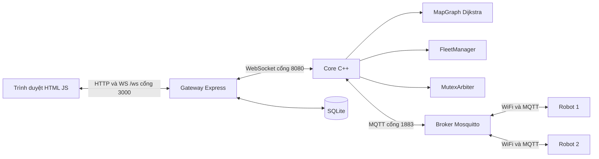

# Kiến trúc hệ thống

Trạng thái: `OBSERVED` cho luồng hiện tại; `PROPOSED` cho các phần mở rộng. Nguồn kỹ thuật: mã được khảo sát ngày 28/09/2026.

## Luồng hiện tại

Robot thật và firmware chưa được xác nhận từ tệp trong workspace. Việc mã đề cập ESP32 không chứng minh phần cứng đã chốt hoặc firmware đã có.

## Chủ sở hữu dữ liệu

| Dữ liệu | Chủ sở hữu dự kiến theo kiến trúc | Bên khác sử dụng |
| --- | --- | --- |
| Vị trí đo, pin, cảm biến vật cản | Firmware | Core nhận telemetry; web hiển thị |
| Phân công, trạng thái nhiệm vụ, lộ trình | Core | Gateway lưu lịch sử; web hiển thị |
| Quyền sử dụng zone | MutexArbiter trong core | Robot xin/cấp/trả quyền |
| Đồ thị bản đồ đang chạy | Core | Web sửa qua API; DB lưu snapshot |
| Lịch sử và KPI | SQLite tại gateway | Web truy vấn |

Snapshot SQLite và bản đồ core có thể lệch nhau. Quy trình áp dụng bản đồ cần kết quả xác nhận từ core và định danh phiên bản trước khi báo thành công; cơ chế này chưa hoàn thiện.

## Luồng giao nhiệm vụ

1. Người vận hành chọn node đích và tạo task trên web.
2. Gateway kiểm tra đầu vào, gửi `add_task` hoặc `direct_goto` tới core.
3. Core chọn xe hoặc xử lý xe chỉ định, tìm đường và publish `GOTO`.
4. Robot kiểm tra command, ACK `cmd_id` và thực hiện theo trạng thái cục bộ.
5. Robot publish telemetry; core cập nhật node, pin, trạng thái và đường còn lại.
6. Core phát state về gateway; gateway lưu lịch sử và broadcast `/ws` tới web.

Hiện HTTP 202 chỉ thể hiện gateway đã chuyển lệnh qua socket. Core chưa có phản hồi xử lý tương quan với request ID; đây là khoảng trống cần giải quyết khi triển khai tính năng.

## Ranh giới điều khiển

Core gửi lộ trình cấp cao. Firmware chịu điều khiển motor, đọc cảm biến và dừng tại robot. Web gửi nhiệm vụ; không phát vòng điều khiển motor theo thời gian thực qua HTTP.

Vùng đường dùng chung cần xem xét robot chiếm chỗ theo kích thước thực và hướng di chuyển. Khóa một node trong đồ thị chưa đủ để chứng minh hai robot không va chạm ở đoạn cạnh hoặc khi quay.

## Hướng mở rộng

- Robot giả lập dùng cùng hợp đồng MQTT để kiểm tra tích hợp sớm.
- Task ID và command session để đồng bộ lịch sử, retry và restart.
- API validation, phản hồi kết quả của core, phiên bản bản đồ.
- Client MCU trực tiếp MQTT hoặc MCU điều khiển motor qua cầu WiFi: chờ sơ đồ phần cứng.
- ROS 2/Gazebo khi yêu cầu vật lý cần thiết; chọn bộ phiên bản tương thích rồi ghi ADR, không bắt buộc đổi core sang ROS.

Xem [quyết định nền](decisions/ADR-001-baseline.md), [hợp đồng mạng](07-network.md) và [hiện trạng](02-current-system.md).
