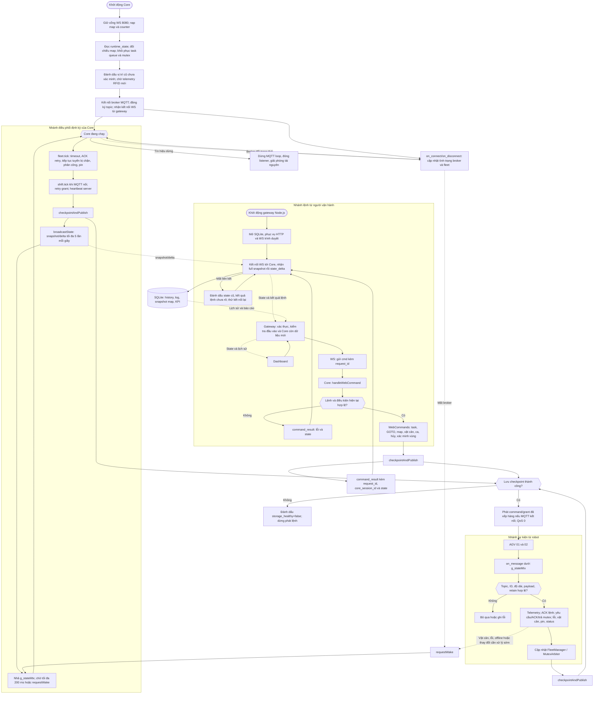
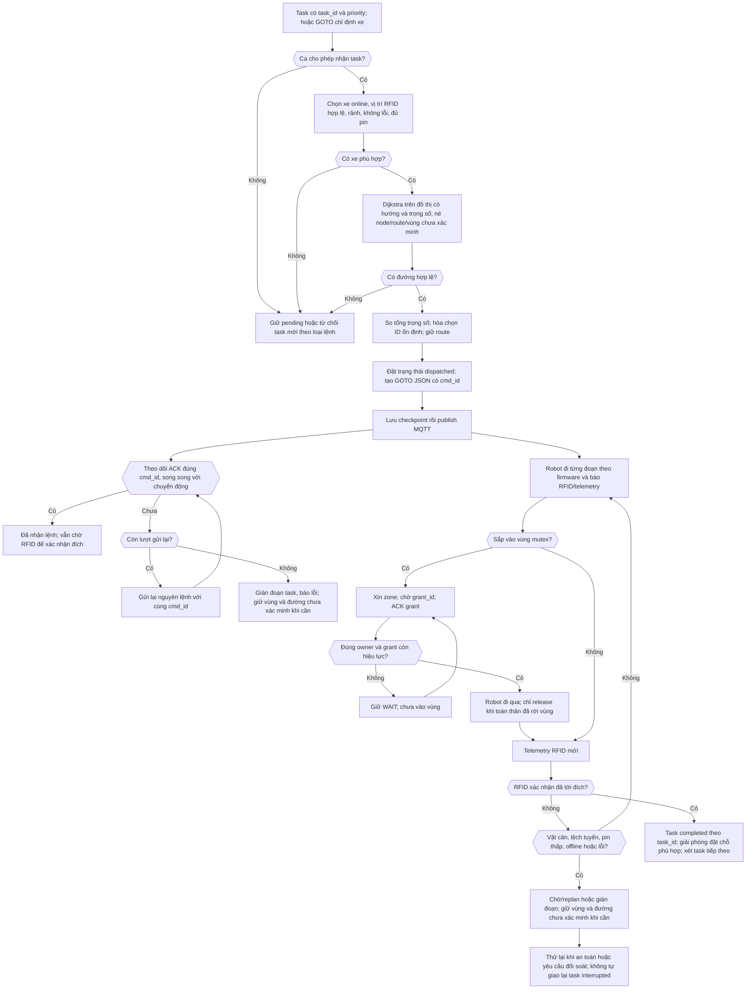

# Lưu đồ xử lý server AGV và lý do lựa chọn

Ngày đối chiếu mã: 07/10/2026. **OBSERVED** trong tài liệu này nghĩa là luồng đọc được từ phiên bản mã trong workspace, không phải kết quả thử hai robot thật. **SOURCE** là mục tiêu đề tài: hai robot đi theo lộ trình, web theo dõi thời gian thực và quản lý bản đồ, tuyến, pin, lỗi. Những tiêu chí định lượng về độ trễ, an toàn hình học và nghiệm thu phần cứng vẫn **OPEN** trong [sổ yêu cầu](requirements/register.md).

## 1. Lưu đồ tổng thể

Sơ đồ gồm gateway Node.js, Core C++ và robot. Ba nhánh nhận sự kiện (lệnh web, MQTT và nhịp định kỳ) cùng làm thay đổi trạng thái Core; khối `checkpointAndPublish()` bảo đảm lưu trạng thái trước khi phát lệnh/quyền MQTT. Mũi tên nét đứt biểu thị tín hiệu phụ hoặc luồng hiển thị/kết quả.

**Cách đọc chính xác:** `g_stateMtx` bảo vệ đoạn xử lý trạng thái trong các nhánh Core, không được giữ trong lúc `wait_for`. `requestWake()` chỉ được gọi ở những sự kiện/callback cần đánh thức vòng lặp; bản tin MQTT thông thường vẫn được xử lý ngay trong callback. `broadcastState()` giới hạn tần suất, không bảo đảm cứ đúng 200 ms có một bản tin. `command_result` xác nhận Core xử lý lệnh, chưa xác nhận xe đã tới đích.

## 2. Lưu đồ quyết định khi giao nhiệm vụ và di chuyển

Đây là phần thuật toán bên trong `FleetManager`, `MapGraph` và `MutexArbiter`; nó không thay thế điều khiển cảm biến/motor trên ESP32.

`ACK` lệnh và `ACK` grant là biên nhận giao tiếp; chỉ RFID/telemetry hợp lệ mới cập nhật vị trí và xác nhận đến đích. Khi xe offline, mất ACK hoặc Core restart, vùng chưa được chứng minh trống vẫn phải giữ để đối soát. Việc robot thực sự rời toàn thân khỏi vùng phụ thuộc firmware và bố trí vật lý; sơ đồ mô tả hợp đồng, chưa chứng minh an toàn thực địa.

## 3. Chức năng, lý do dùng và sự phù hợp với đề tài

| Khối | Chức năng đang có | Lý do dùng trong hệ thống hai AGV |
| --- | --- | --- |
| HTTP, WebSocket và MQTT | HTTP nhận truy vấn/lệnh; WebSocket đẩy state; MQTT trao đổi telemetry và command với xe | Mỗi kênh phù hợp một kiểu trao đổi: thao tác có phản hồi, giám sát liên tục và sự kiện bất đồng bộ từ thiết bị IoT. |
| Gateway HTTP/WS và SQLite | Nhận thao tác web, kiểm tra quyền/đầu vào, chuyển lệnh có `request_id`, lưu lịch sử và gửi state cho trình duyệt | Tách giao diện và báo cáo khỏi quyết định điều khiển; web có thể phân biệt lệnh được Core chấp nhận với kết quả chuyển động thật. |
| Core C++ và `g_stateMtx` | Quản lý trạng thái map/fleet/mutex nhất quán giữa luồng WS, MQTT và vòng lặp chính | Hai xe và người vận hành có thể tạo sự kiện đồng thời; quyết định phân công không được đọc trạng thái nửa cập nhật. |
| `FleetManager::tick()` | Kiểm tra telemetry timeout, ACK, tuyến bị chặn, phân công và pin | Xe có thể mất mạng, gặp vật cản hoặc thiếu ACK trong lúc web không gửi lệnh; server vẫn cần kiểm tra và phản ứng định kỳ. |
| Dijkstra và tổng trọng số | Tìm tuyến trên graph kho có hướng, chặn node/vùng không dùng được; so chi phí để chọn xe | Kho được mô hình hóa bằng node RFID và cạnh có trọng số. Dijkstra cho kết quả đường ngắn nhất theo trọng số không âm; không tuyên bố tối ưu toàn đội hay tránh va chạm hình học. |
| Mutex zone, grant/ACK/release | Mỗi vùng chung có owner và hàng chờ; quyền được cấp theo token `grant_id` | Hai robot là hai thiết bị riêng nên `std::mutex` trong một tiến trình không thể khóa giao lộ vật lý. Quyền vùng qua MQTT ngăn cả hai cùng được phép vào một vùng theo mô hình logic. |
| Telemetry RFID, pin, lỗi | Cập nhật vị trí đo được, xét hoàn thành task, phát hiện pin thấp/lỗi/mất liên lạc | Đề tài cần hiển thị bản đồ, tuyến, pin và lỗi theo thời gian thực. Server không được suy vị trí từ lệnh đã gửi hoặc ACK. |
| `ShiftController` và trạm riêng | Bắt đầu/kết thúc ca, hoàn tất task đang chạy rồi về S1/S2, kiểm tra điều kiện mở ca | Giữ quy trình vận hành hai xe rõ ràng; sau restart phải có telemetry mới trước khi phân công. Chế độ thử một xe có điều kiện riêng. |
| Checkpoint, counter và phục hồi | Lưu queue/mutex trước publish; giữ `cmd_id`/`task_id` qua restart; đánh dấu vị trí cũ chưa xác minh | Tránh tạo lại lệnh/ID hoặc giải phóng giao lộ chỉ vì server khởi động lại; giúp đối soát lịch sử nhiệm vụ. |
| Snapshot/delta và giới hạn 5 Hz | Core phát trạng thái cho gateway; gateway phát cho browser và ghi DB | Dashboard cần theo dõi gần thời gian thực nhưng không cần phát lại toàn bộ bản đồ hoặc ghi DB theo từng vòng xử lý. |
| `requestWake()` cùng chờ tối đa 200 ms | Đánh thức vòng điều phối sớm khi có sự kiện cần phản ứng | Vật cản/lỗi không phải đợi đủ nhịp định kỳ; vẫn có nhịp nền để kiểm tra timeout, ACK và pin. |

## 4. Đối chiếu mục tiêu đề tài

| Mục tiêu SOURCE | Phần lưu đồ đáp ứng | Phạm vi kết luận |
| --- | --- | --- |
| SRC-01: hai robot đi theo lộ trình định trước | Dijkstra, chọn xe, command `GOTO`, đặt trước route và mutex | Có logic lập và điều phối tuyến; chưa chứng minh hai xe thật chạy an toàn. |
| SRC-02: theo dõi thời gian thực trên web | Telemetry MQTT → Core → snapshot/delta WS → dashboard | Có cập nhật gần thời gian thực; ngưỡng độ trễ nghiệm thu chưa chốt. |
| SRC-03: quản lý bản đồ, lộ trình, pin, lỗi | WebCommands, `FleetManager`, `ShiftController`, history SQLite | Có chức năng phần mềm tương ứng; độ chính xác cảm biến/pin thật cần kiểm chứng. |
| SRC-04: dữ liệu cho báo cáo nghiên cứu | Task history, log, KPI và kịch bản kiểm thử | Cung cấp dữ liệu đầu vào; chưa thay mẫu báo cáo chính thức của học viện. |

## 5. Giới hạn cần ghi khi đưa vào báo cáo

- Lưu đồ mô tả **logic phần mềm hiện có**, không phải bằng chứng hai robot thật đã chạy an toàn. Cần thử bàn, mô phỏng và đo thực tế cho kích thước xe, khoảng dừng, RFID, motor và vùng giao nhau.
- `MQTT QoS 0` cùng ACK ứng dụng/retry giúp phát hiện và xử lý một số trường hợp mất bản tin, không bảo đảm lệnh đã được thực thi. Kết quả task dựa trên telemetry RFID.
- Dijkstra giải bài toán đường đi trên đồ thị; chính sách đặt trước route và mutex mới xử lý xung đột logic giữa hai xe. An toàn hình học và deadlock nhiều vùng vẫn cần kiểm chứng.
- Nội dung task vận chuyển hàng nhiều chặng, tải trọng và chỉ tiêu độ trễ/nghiệm thu của kho thật còn **OPEN** trong sổ yêu cầu. Không suy ra chức năng pickup/dropoff vật lý từ một task `GOTO` tới node.

## Nguồn đối chiếu

- Core và xử lý ba nhánh: [`src/AGVserver.cpp`](../src/AGVserver.cpp).
- Phân công, task, ACK, pin: [`src/FLeetmanager.hpp`](../src/FLeetmanager.hpp).
- Vùng chung: [`src/Mutexarbiter.hpp`](../src/Mutexarbiter.hpp).
- Gateway, lịch sử và API: [`AGVwebserver/gateway.js`](../AGVwebserver/gateway.js), [hợp đồng web/server](../contracts/web-server.md).
- Mục tiêu đề tài, thuật toán và giới hạn: [tổng quan](00-project-brief.md), [thuật toán](05-algorithms.md), [gia cố](18-hardening.md).
