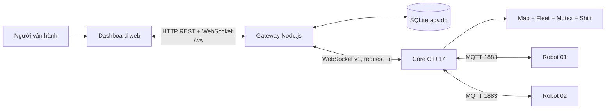
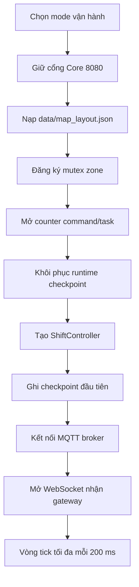
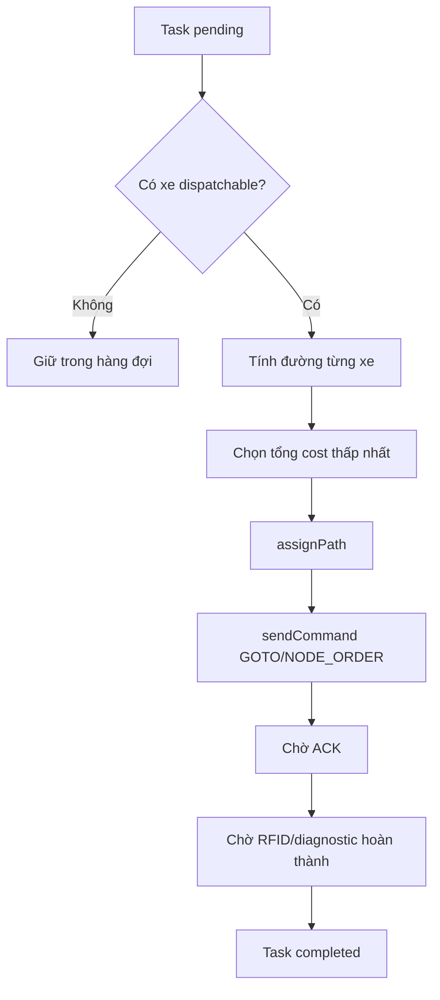
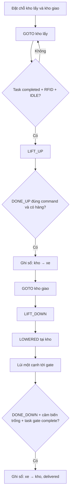
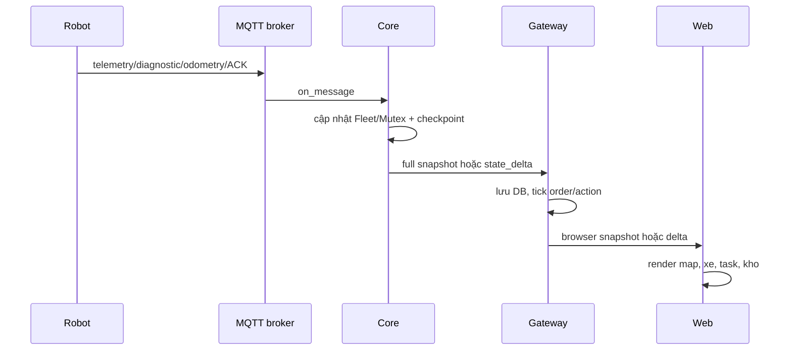
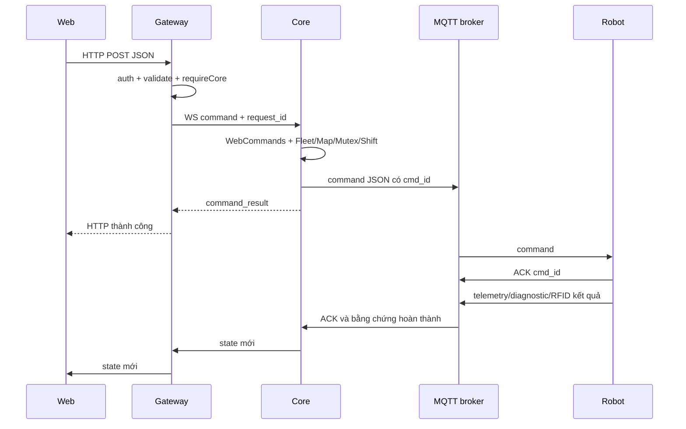

# Báo cáo kiến trúc và hoạt động Server – Web của hệ thống AGV

Ngày đối chiếu mã: **29/10/2026**\
Phạm vi: **Core C++17, gateway Node.js/Express/SQLite, dashboard HTML/CSS/JavaScript và các kênh giao tiếp liên quan**.\
Trạng thái: **OBSERVED** từ source hiện tại; tài liệu này không phải kết quả chạy xe thật.

## 1. Cách giới thiệu ngắn trước hội đồng

Hệ thống được chia thành ba tầng, mỗi tầng có một trách nhiệm riêng:

1. **Core C++** là bộ não điều phối thời gian thực: giữ bản đồ, trạng thái xe, nhiệm vụ, tìm đường, khóa vùng giao nhau, kiểm ACK, xử lý lỗi và quyết định lệnh nào được phát xuống robot.
2. **Gateway Node.js** là cầu nối nghiệp vụ: cung cấp REST API và WebSocket cho trình duyệt, chuyển lệnh tới Core, lưu SQLite, điều phối đơn chuyển kệ, sổ kho, báo cáo và bảo mật truy cập.
3. **Dashboard web** là lớp tương tác: hiển thị bản đồ, hai xe, hàng hóa, nhiệm vụ, kho, ca làm việc và báo cáo; nhận thao tác người dùng nhưng không tự quyết định robot đã hoàn thành.

Robot không nhận lệnh trực tiếp từ trình duyệt. Luồng đúng là:



Điểm quan trọng để trình bày: **Core sở hữu sự thật vận hành**, **gateway sở hữu dữ liệu nghiệp vụ và lịch sử**, còn **web chỉ biểu diễn và gửi yêu cầu**.

## 2. Các tiến trình và cổng mạng

| Thành phần | Công nghệ | Cổng mặc định | Vai trò |
| --- | --- | ---: | --- |
| Core | C++17, libmosquitto, WebSocket tự cài đặt | 8080 | Điều phối xe và trả snapshot trạng thái |
| Gateway | Node.js CommonJS, Express, `ws` | 3000 | REST API, WebSocket trình duyệt, SQLite |
| MQTT broker | MQTT | 1883 | Chuyển command, telemetry, ACK, diagnostic và mutex |
| Trình duyệt | HTML/CSS/JavaScript thuần | truy cập gateway | Giao diện giám sát và điều khiển |

Các giá trị có thể cấu hình bằng biến môi trường:

| Cấu hình | Nơi đọc | Ý nghĩa |
| --- | --- | --- |
| `AGV_CORE_WS_PORT` | `src/core/AGVserver.cpp` | Cổng WebSocket của Core, mặc định 8080 |
| `AGV_MQTT_HOST`, `AGV_MQTT_PORT` | `src/core/AGVserver.cpp` | Địa chỉ broker MQTT, mặc định `127.0.0.1:1883` |
| `AGV_MAP_PATH` | `src/core/AGVserver.cpp` | File bản đồ Core |
| `AGV_COMMAND_ID_PATH`, `AGV_TASK_ID_PATH` | `src/core/AGVserver.cpp` | Counter lệnh và nhiệm vụ bền vững |
| `AGV_RUNTIME_STATE_PATH`, `AGV_SHIFT_STATE_PATH` | `src/core/AGVserver.cpp` | Checkpoint runtime và trạng thái ca |
| `AGV_WS_URL` | `AGVwebserver/gateway.js` | Gateway kết nối Core, mặc định `ws://127.0.0.1:8080` |
| `PORT`, `HOST` | `AGVwebserver/gateway.js` | Cổng/địa chỉ HTTP gateway, mặc định 3000/loopback |
| `AGV_AUTH_TOKEN`, `AGV_ALLOWED_ORIGINS` | `AGVwebserver/gateway.js`, `security.js` | Xác thực và giới hạn Origin |
| `AGV_HTTPS_CERT`, `AGV_HTTPS_KEY` | `AGVwebserver/gateway.js` | Bật HTTPS/WSS cho dashboard |

## 3. Quyền sở hữu dữ liệu

Không nên để hai tầng cùng tự quyết định một trạng thái. Source hiện tại phân quyền như sau:

| Dữ liệu | Thành phần sở hữu | Thành phần chỉ đọc/chiếu |
| --- | --- | --- |
| Map đang chạy, xe, đường đi, task, mutex, lift/cargo ảo | Core | Gateway và web |
| Lịch sử xe, task, log, snapshot map, KPI | Gateway/SQLite | Web |
| Đơn chuyển kệ, đặt chỗ kho, mã kệ, báo cáo ca | Gateway/SQLite | Web; Core chỉ thực hiện primitive di chuyển/nâng hạ |
| Trạng thái vật lý tức thời của robot | Firmware phát qua MQTT, Core kiểm và tổng hợp | Gateway/web |
| Dữ liệu đang hiển thị | Web cache snapshot gần nhất | Không được dùng làm bằng chứng vật lý độc lập |

Ba mức xác nhận phải phân biệt:

| Mức | Ví dụ | Chứng minh được gì |
| --- | --- | --- |
| Gateway/Core chấp nhận | HTTP 200/201 và `command_result.ok=true` | Yêu cầu hợp lệ và Core đã xử lý yêu cầu |
| Robot ACK | MQTT `agv/{id}/ack` chứa `cmd_id` | Firmware đã nhận hoặc nhận ra lệnh trùng |
| Hoàn thành vật lý | RFID đích, state IDLE, diagnostic/lift/cargo đúng phiên và đúng ID | Xe đã tới hoặc chu kỳ nâng/hạ đã đạt điều kiện |

HTTP thành công hoặc ACK **không đồng nghĩa** xe đã chạy xong.

## 4. Core C++ – bộ điều phối trung tâm

### 4.1 Entry point `src/core/AGVserver.cpp`

Đây là file ghép toàn bộ Core. Các hàm chính:

| Hàm | Hoạt động |
| --- | --- |
| `main` | Gọi `runCore`; bắt lỗi khởi động và trả mã lỗi |
| `runCore` | Khởi tạo mode, map, counter, checkpoint, ca, MQTT, WebSocket và vòng tick |
| `startupMode` | Chọn phạm vi vận hành như `active01`, `active02`, `active-both` |
| `stateSnapshot` | Ghép map, fleet, mutex, shift, log, health và session thành JSON |
| `checkpointAndPublish` | Ghi checkpoint bền vững rồi đẩy các MQTT message đang chờ |
| `publishTo` | Xếp bản tin MQTT vào hàng phát của Core |
| `startMqtt` | Khởi tạo libmosquitto và callback mạng |
| `on_connect` | Subscribe các topic robot và cập nhật trạng thái MQTT |
| `on_disconnect` | Đánh dấu mất broker, báo fleet mất mạng |
| `on_message` | Parse topic/payload rồi chuyển telemetry, ACK, error, odometry, diagnostic và mutex vào module tương ứng |
| `createWebSocketListener` | Mở listener cho gateway ở cổng Core |
| `wsAcceptLoop` | Nhận các kết nối gateway/Core client |
| `wsClientThread` | Handshake, đọc command WebSocket và trả `command_result` |
| `handleWebCommand` | Parse JSON rồi gọi `WebCommands::execute` |
| `broadcastState` | Gửi snapshot/delta trạng thái tới các Core WebSocket client |
| `requestWake` | Đánh thức vòng tick sớm khi có sự kiện quan trọng |

Thứ tự khởi động của `runCore`:



Trong mỗi vòng tick, Core thực hiện:

1. Thử phục hồi storage nếu lần ghi trước lỗi.
2. `FleetManager::tick()` để dispatch, kiểm ACK, timeout, pin và resume.
3. `ShiftController::tick()` để điều khiển vòng đời ca.
4. Retry mutex grant chưa ACK.
5. Phát heartbeat `agv/server/heartbeat`.
6. Ghi checkpoint và flush MQTT.
7. Phát state cho gateway/web.

### 4.2 `WebCommands` – cổng lệnh từ gateway vào Core

File: `include/commands/WebCommands.hpp`.

`execute(json)` là dispatcher trung tâm. Nó kiểm kiểu/range/điều kiện an toàn rồi gọi đúng module:

| Nhóm lệnh | Nhánh trong `execute` | Module được gọi |
| --- | --- | --- |
| Ca làm việc | `start_shift`, `end_shift` | `ShiftController` |
| Nhiệm vụ | `add_task`, `direct_goto`, `cancel_task`, `resume_task` | `FleetManager` |
| Nâng/hạ | `warehouse_lift`, `reconcile_test_cargo` | `FleetManager` |
| Phục hồi | `recover_vehicle`, `recover_home`, `recover_node`, `confirm_recovery_heading`, `clear_error` | `FleetManager` |
| Mutex | `confirm_zone_clear` | `MutexArbiter` + kiểm fleet/shift |
| Robot | `remove_agv` | `FleetManager`, chỉ khi OFFLINE và không giữ zone |
| Bản đồ | `load_map_data`, `add_node`, `remove_node`, `add_edge`, `remove_edge`, `save_map` | `MapGraph` |
| Vật cản | `set_obstacle` | `FleetManager`/`MapGraph` |
| Mô phỏng | `sim_edge_obstacle`, `sim_replan` | Chỉ khi bật simulation mode |

Mọi phản hồi có `request_id`, `ok`, và khi lỗi có `status/error`. Gateway dùng `request_id` cộng `core_session_id` để không ghép nhầm phản hồi của phiên Core khác.

### 4.3 `MapGraph` – bản đồ và tìm đường

File: `include/map/MapGraph.hpp`.

| Nhóm hàm | Vai trò |
| --- | --- |
| `loadFromFile`, `loadFromJson`, `saveToFile` | Nạp/kiểm/lưu graph JSON |
| `addNode`, `removeNode`, `addEdge`, `removeEdge` | Chỉnh cấu trúc map |
| `setObstacle`, `setEdgeObstacle`, `expireObstacles` | Khóa node/cạnh và TTL |
| `findShortestPath` | Dijkstra trên cạnh có hướng, trọng số không âm |
| `pathCost`, `undirectedDistance`, `straightLineDistance` | Tính chi phí/quãng cách phục vụ phân công |
| `mutexComponent`, `mutexZones` | Xác định vùng giao nhau cần loại trừ tương hỗ |
| `nearestCharging`, `chargingStations` | Tìm trạm sạc |
| `edgeGeometry` | Trả hình học cạnh thẳng/bo để chiếu vị trí |
| `toJson` | Tạo snapshot map cho gateway/web |

Muốn thay thuật toán tìm đường, bắt đầu tại `findShortestPath`; muốn thay map vật lý, sửa `data/map_layout.json` và bảo đảm firmware dùng cùng map/role RFID.

### 4.4 `FleetManager` – trạng thái xe và vòng đời nhiệm vụ

File: `include/core/FLeetmanager.hpp`. Đây là module lớn nhất, nên hiểu theo nhóm thay vì đọc tuần tự 2.600 dòng.

| Nhóm | Hàm tiêu biểu | Chức năng |
| --- | --- | --- |
| Cấu hình | `setActiveRobots`, `setBatteryThresholds`, `setAckTimeout`, `setOfflineTimeout` | Xác định xe tham gia và các ngưỡng |
| Đăng ký/trạng thái | `addAGV`, `removeAGV`, `updateTelemetry`, `reportOffline`, `reportError` | Tạo/cập nhật state machine từng xe |
| Nhiệm vụ | `addTask`, `directGoto`, `dispatchPending`, `assignPath` | Tạo task, chọn xe và gán đường |
| Lệnh/ACK | `sendCommand`, `reportAck`, `checkAcks` | Cấp `cmd_id`, gửi lệnh, retry và báo mất ACK |
| Timeout | `checkTimeouts`, `checkLiftTimeouts` | Phát hiện telemetry/lift quá hạn |
| Replan | `replanAGV`, `replanAffectedAgvs`, `resumeBlocked` | Tính lại đường khi lỗi/vật cản/footprint |
| Odometry | `bindEncoderSession`, `observeOdometry`, `observeStoppedPosition` | Nhận ước lượng encoder đúng boot/connection/session |
| Diagnostic | `observeMotionDiagnostic`, `observeHeadingDiagnostic`, `observeNodeOrderRequest` | Kiểm motor, hướng và yêu cầu theo node |
| Nâng/hạ | `startLift`, `observeLift`, `observeCargoSensor`, `cargoSensorReadyNoLock` | Theo dõi đúng command ID, sensor và cargo ảo |
| Phục hồi | `recoverVerifiedNode`, `confirmRecoveryHeading`, `resumeTask`, `clearError` | Phục hồi có xác nhận RFID/dừng/hướng |
| Kết ca | `endShiftWork`, `returnToHome`, `beginWorkFromHome` | Dừng nhận việc, xử lý task cũ và đưa xe về trạm |
| Lưu bền | `durableSnapshot`, `restore` | Chỉ lưu trạng thái an toàn để khôi phục |
| Xuất state | `toJson` | Snapshot fleet cho gateway/web |

Luồng phân công cơ bản:



### 4.5 `MutexArbiter` – chống hai xe vào cùng vùng

File: `include/utils/Mutexarbiter.hpp`.

| Hàm | Hoạt động |
| --- | --- |
| `registerZone` | Tạo trạng thái cho một vùng mutex |
| `requestZone` | Nếu rảnh thì cấp; nếu bận thì xếp FIFO |
| `grant` | Tạo grant có `grant_id` và trạng thái chờ ACK |
| `acknowledge` | Xác nhận robot đã nhận quyền |
| `releaseZone` | Trả quyền và cấp cho người chờ tiếp theo |
| `retryGrants` | Gửi lại grant chưa ACK |
| `setBlockedZones` | Chặn vùng do xe dừng/lỗi dù chưa có owner |
| `confirmClear` | Người vận hành xác nhận vùng thực tế đã trống |
| `cancelWaiting` | Bỏ yêu cầu đang xếp hàng của xe |
| `restore`, `toJson` | Khôi phục và xuất snapshot |

Nguyên tắc an toàn: mất telemetry không được tự xem là xe đã rời vùng; owner/footprint được giữ tới khi có bằng chứng clearance.

### 4.6 `ShiftController` – vòng đời ca

File: `include/core/ShiftController.hpp`.

Các pha chính là `CLOSED → RUNNING → CLOSING → CLOSED`.

| Hàm | Hoạt động |
| --- | --- |
| `start` | Kiểm xe/trạm/mutex và mở nhận nhiệm vụ |
| `end` | Chuyển sang kết ca, ngừng nhận việc mới |
| `tick` | Theo dõi điều kiện hoàn thành kết ca |
| `transition` | Ghi chuyển pha bền vững |
| `snapshot` | Xuất pha, scope, home station và lý do chờ |

### 4.7 Các module hỗ trợ Core

| File/module | Hàm chính | Trách nhiệm |
| --- | --- | --- |
| `include/commands/CommandIds.hpp` | `next`, `ensureAbove`, `reserve` | Cấp ID tăng dần và không rewind sau restart |
| `include/core/RuntimeStore.hpp` | `load`, `save`, `mapsCompatible`, `migrateRoundedMap` | Checkpoint runtime và migration map có kiểm soát |
| `include/core/PhysicalLayout.hpp` | `home`, `gate`, `warehouse`, `validate` | Role cố định của S/K/G theo robot và firmware |
| `include/core/NodeManeuver.hpp` | `heading`, `direction`, `plan` | Tính hướng/rẽ/quay tại node |
| `include/core/EncoderOdometry.hpp` | `parse`, `bind`, `accept` | Kiểm schema và phiên dữ liệu encoder |
| `include/map/EdgeGeometry.hpp` | `direction`, `heading`, `point` | Chiếu điểm trên cạnh thẳng/bo |
| `include/utils/AtomicFile.hpp` | `durableReplaceFile` | Ghi file tạm rồi thay nguyên tử |

## 5. Gateway Node.js – API, nghiệp vụ và lưu trữ

### 5.1 `server.js` – entrypoint

File này chỉ tạo `createGateway()`, gọi `start()`, in địa chỉ dashboard và dọn tài nguyên khi có `SIGINT/SIGTERM`. Muốn thay logic API không sửa ở đây; sửa `gateway.js` hoặc service tương ứng.

### 5.2 `gateway.js` – bộ ghép HTTP/WS/Core

`createGateway(options)` tạo toàn bộ gateway. Các hàm quan trọng:

| Hàm | Hoạt động |
| --- | --- |
| `browserState` | Ghép Core state với history, orders, warehouse, actions và location names |
| `broadcast` | Phát full state hoặc delta tới browser, tối đa khoảng 5 lần/giây |
| `onState` | Kiểm snapshot Core, chống state cũ, lưu DB, tick order/action và broadcast |
| `connectCore` | Kết nối/reconnect WebSocket tới Core |
| `failRequests` | Kết thúc các request đang chờ khi mất Core |
| `requireCore` | Chặn điều khiển nếu state cũ, storage lỗi, protocol sai hoặc MQTT mất |
| `command` | Gắn UUID `request_id`, gửi Core, chờ đúng phiên và timeout |
| `task` | Chuẩn hóa endpoint task trực tiếp/tự chọn xe |
| `locationNamesBlockReason` | Giải thích vì sao chưa thể đổi tên kho/trạm |
| `start` | Bind HTTP/HTTPS rồi kết nối Core |
| `close` | Đóng scheduler, Core socket, browser WS, server và DB |

Gateway giữ hai luồng WebSocket khác nhau:

- **Gateway ↔ Core:** nhận full snapshot, sau đó `state_delta` có `base_state_seq/state_seq`; lệnh có `request_id` và `command_result`.
- **Gateway ↔ Browser:** `/ws?delta=1`; browser nhận full snapshot đầu tiên, sau đó delta. Nếu baseline sai thì client phải reconnect.

`broadcast` bảo vệ browser chậm bằng `bufferedAmount > 2 MiB` thì terminate client. Cơ chế này nằm ở gateway; nó không thay thế việc tách send WebSocket khỏi khóa điều phối trong Core.

### 5.3 Các nhóm REST API

| Nhóm | Endpoint tiêu biểu | Module xử lý |
| --- | --- | --- |
| Đăng nhập | `/auth/status`, `/auth/login`, `/auth/logout` | `gateway.js`, `security.js` |
| Health/state | `/api/health`, `/api/state`, `/api/agvs`, `/api/mutex` | `gateway.js` |
| Ca | `/api/shift/start`, `/api/shift/end`, `/api/shift/review`, `/api/shift/reconcile` | `gateway.js`, `shift-review.js` |
| Task | `/api/tasks`, `/api/agvs/:id/goto`, `/api/tasks/cancel`, `/api/tasks/:id/resume` | `gateway.js` → Core |
| Phục hồi | `/api/agvs/:id/recover`, `/recovery-heading`, `/clear-error` | `gateway.js` → Core |
| Đơn hàng | `/api/orders`, `/api/orders/:id/resume`, `/resolve` | `orders.js` |
| Kho | `/api/warehouse`, `/configure`, `/events`, `/reports` | `warehouse-inventory.js` |
| Nâng/hạ độc lập | `/api/agvs/:id/warehouse-action`, `/api/warehouse-actions/:id/resume` | `warehouse-actions.js` |
| Map | `/api/map`, `/node`, `/edge`, `/obstacle`, `/snapshots` | `gateway.js` → Core/DB |
| Lịch sử/báo cáo | `/api/tasks/history`, `/api/agvs/:id/history`, `/api/logs`, `/api/kpi/*` | `db.js` |

Quy ước response:

- API danh sách trả **array trực tiếp**.
- POST/DELETE thành công thường trả `{ok:true,...}`.
- API điều khiển chỉ trả thành công sau khi Core chấp nhận; chưa khẳng định robot hoàn tất.
- Timeout/mất kết nối trả trạng thái **unknown**; gateway không tự retry lệnh chuyển động.

Danh sách endpoint và payload đầy đủ nằm trong `contracts/web-server.md`.

### 5.4 `db.js` – SQLite và báo cáo

`createDatabase(dbPath)` mở SQLite, bật cấu hình và tạo/migrate schema. Các nhóm hàm:

| Nhóm | Hàm tiêu biểu | Bảng liên quan |
| --- | --- | --- |
| State và task | `enqueueState`, `syncTasks`, `getOpenTasks`, `getTaskHistory` | `task_log`, `task_status_events` |
| Xe | `logAgvEventIfChanged`, `getAgvHistory` | `agv_events` |
| Vật cản/lỗi | `logObstacle`, `insertAgvError` | `obstacle_log`, `agv_error_log` |
| Log hệ thống | `insertSystemLog`, `getRecentSystemLogs` | `system_log` |
| Snapshot map | `saveMapSnapshot`, `getAllMapSnapshots`, `deleteMapSnapshot` | `map_snapshots` |
| Đơn | `saveOrder`, `getOrders` | `warehouse_orders` |
| Tên vị trí | `loadLocationNames`, `saveLocationNames` | `location_names` |
| KPI | `computeKpiReport`, `computeAgvUtilization`, `getKpiHistory` | `kpi_reports` |

SQLite là lịch sử/nghiệp vụ, không thay Core làm nguồn state thời gian thực.

### 5.5 `orders.js` – điều phối đơn chuyển kệ

`createOrderService` trả service quản lý vòng đời đơn. Các hàm chính:

| Hàm | Hoạt động |
| --- | --- |
| `create` | Kiểm đơn, lập kế hoạch, giữ chỗ kho và lưu DB |
| `preview`, `planQueued` | Ghép các điểm lấy/giao và chuẩn bị item |
| `eligible`, `selectedRobot` | Xác định xe có thể nhận item |
| `dispatch` | Gửi task di chuyển tới Core |
| `beginLiftWait`, `dispatchLift` | Gửi primitive nâng/hạ và giữ command ID |
| `processItem` | State machine của từng lượt lấy → giao → gate |
| `tick`, `runTick` | Tiến vòng đời theo Core snapshot mới |
| `resume` | Tiếp tục chặng di chuyển được phép, không tự replay servo |
| `resolve` | Đối soát/rollback lượt thử theo xác nhận vật lý |
| `interrupt`, `interruptAll`, `endShift` | Đưa đơn sang cần chú ý khi mất bằng chứng |
| `linkTaskHistory` | Liên kết task Core/DB với item đúng ID/phiên |

Luồng một kệ:



### 5.6 `order-planner.js` – ghép nguồn/đích

| Hàm | Hoạt động |
| --- | --- |
| `shortestRoute` | Dijkstra nhẹ trên snapshot map để ước lượng tuyến |
| `shortestCost` | Lấy cost của tuyến |
| `planOrder` | Ghép pickup–delivery bằng chi phí nhỏ nhất |

Planner gateway chỉ lập kế hoạch nghiệp vụ; Core vẫn là nơi quyết định đường chạy thực tế tại thời điểm dispatch.

### 5.7 `warehouse-actions.js` – thao tác nâng/hạ độc lập

| Hàm | Hoạt động |
| --- | --- |
| `create` | Tạo action pickup/dropoff cho một xe/kho |
| `dispatch` | Gửi task tới kho hoặc gate |
| `beginService`, `inspectAndStart` | Kiểm xe đã ở đúng RFID/IDLE |
| `startServo` | Gửi `warehouse_lift` và ghi command ID |
| `advance`, `tick` | Tiến state action theo snapshot Core |
| `interrupt`, `resume`, `endShift` | Gián đoạn/tiếp tục hợp lệ/kết thúc ca |

Action độc lập hiện giữ danh sách hoạt động trong RAM; khi gateway restart, dữ liệu sổ kho có thể còn nhưng ngữ cảnh action cần đối soát. Đây là điểm cần nói rõ nếu hội đồng hỏi về recovery sau restart.

### 5.8 `warehouse-inventory.js` – sổ kho và tính nhất quán

| Hàm | Hoạt động |
| --- | --- |
| `configure` | Nhập trạng thái thực tế K1–K6 trước mở ca |
| `assertPlan`, `checkMove` | Kiểm nguồn có kệ, đích trống và không trùng giữ chỗ |
| `reserve` | Đặt chỗ cho một item/action |
| `confirmLift` | Chuyển location kệ giữa slot và robot |
| `confirmMissing` | Ghi kệ cần đối soát khi sensor cho thấy lệch |
| `resumeMove` | Kiểm revision và tiếp tục move |
| `rollbackPlan`, `rollbackOrder` | Hoàn tác lượt thử sau xác nhận vật lý |
| `observeShift`, `finishShift` | Theo dõi và chốt báo cáo kho cuối ca |
| `currentSnapshot` | Xuất snapshot sổ kho |

Các bảng riêng: `warehouse_inventory`, `warehouse_events`, `warehouse_shift_reports`. Thay đổi sổ kho và event được thực hiện cùng transaction để tránh lệch dữ liệu.

### 5.9 Các service nhỏ nhưng quan trọng

| File | Hàm chính | Trách nhiệm |
| --- | --- | --- |
| `cargo-proof.js` | `cargoReading`, `cargoResult`, `loweredForExit`, `dropoffDoneAtGate` | Chuẩn hóa bằng chứng LM393/lift/gate |
| `location-names.js` | `snapshot`, `assertRevision`, `resolve`, `swap` | Đổi nhãn K/S nhưng giữ ID vật lý |
| `shift-review.js` | `observe`, `snapshot`, `reconcile` | Bản chụp đối soát lỗi ca có token |
| `security.js` | `authorized`, `originAllowed`, `middleware` | Token/cookie, Origin và quyền gọi API |

## 6. Dashboard web – giao diện và cách render

### 6.1 `index.html` – cấu trúc trang

Trang có ba view chính:

- **Tổng quan:** trạng thái xe/kho, bản đồ, nhiệm vụ, tạo công việc và ca.
- **Bản đồ:** sơ đồ vận hành, chỉnh nhãn vị trí và snapshot map.
- **Báo cáo:** KPI, kho cuối ca và nhật ký.

`index.html` chứa DOM, form và dialog; CSS/JS được tách theo chức năng. Stack vẫn là HTML/JS thuần, không có React/Vue.

### 6.2 `public/dashboard.js` – controller chính của trình duyệt

Các nhóm hàm:

| Nhóm | Hàm tiêu biểu | Chức năng |
| --- | --- | --- |
| Kết nối | `connect`, `updateConnection`, `dataFresh`, `controlsReady` | Kết nối `/ws?delta=1`, ghép delta, phát hiện stale |
| HTTP | `api`, `control` | Gọi REST, chuẩn hóa lỗi, khóa thao tác khi bận |
| Render tổng | `render`, `renderSummary`, `renderShift`, `renderMutex` | Phân phối state cho các module con |
| Task | `addTask`, `cancelTask`, `selectAgv`, `onNodeClick` | Chọn xe/đích và gửi yêu cầu |
| Đơn/kho | `submitOrder`, `warehouseAction`, `renderOrders` | Tạo đơn hoặc thao tác nâng/hạ |
| Map snapshot | `saveNamedMap`, `loadMapList`, `applyPreviewedMap` | Lưu/xem/apply snapshot |
| Lịch sử | `loadRobotHistory`, `loadStoredLogs` | Tải dữ liệu SQLite qua API |
| Auth | `checkAuthentication`, `logout` | Kiểm phiên và đăng xuất |

`render(state)` là điểm trung tâm: cập nhật cache `lastState`, gọi renderer map, xe, nhiệm vụ, kho, ca và báo cáo. Khi sửa field state, cần kiểm cả producer gateway và consumer tại đây/module con.

### 6.3 `dashboard-map.js` – bản đồ SVG

| Hàm | Hoạt động |
| --- | --- |
| `computeMapTransform` | Đổi tọa độ map sang viewport SVG |
| `roundedEdgePath` | Vẽ cạnh bo theo geometry |
| `renderStaticMap` | Vẽ node/cạnh/nhãn và cache phần tĩnh |
| `renderDynamicMap` | Vẽ tuyến, robot, heading, cargo và cảnh báo sonar |
| `robotMarkerPoint`, `markerPoint` | Chọn RFID hoặc vị trí encoder ước lượng |
| `animateRobotMarkers` | Nội suy marker bằng `requestAnimationFrame` |
| `sonarDetections` | Đưa cảnh báo vật cản lên map |
| `drawMap`, `renderMap`, `clearMapRenderCache` | Điều phối render/cache |

Khối hàng trên xe được tạo trong `renderDynamicMap` khi `robot.virtual_cargo === true`; vì nó nằm trong group SVG của robot nên di chuyển cùng marker. Đây là cargo ảo theo kết quả chu kỳ nâng/hạ, không phải nhận dạng mã kệ.

### 6.4 `dashboard-vehicles.js` – hai thẻ xe 01/02

| Hàm | Hoạt động |
| --- | --- |
| `vehicleParticipates`, `vehicleCanSelect` | Kiểm scope và khả năng chọn xe |
| `vehicleBattery` | Chọn phần trăm pin hợp lệ để hiển thị |
| `renderVehicleTelemetry` | RFID, pin, tốc độ, cargo, lift, tuổi dữ liệu |
| `renderVehicleActions` | Nút chọn, lịch sử, khôi phục, gỡ xe |
| `renderVehicleCards` | Luôn duy trì hai slot UI 01/02 |
| `markVehicleRemoved` | Hiển thị xe đã gỡ mà không tạo robot giả |

### 6.5 `mission-model.js` và `dashboard-missions.js`

`mission-model.js` chuyển orders/task history thành model chung bằng `buildMissionRows`. `dashboard-missions.js` phụ trách filter, search, badge, chi tiết, cancel, resume và delete logic.

| Hàm | Hoạt động |
| --- | --- |
| `missionCategory`, `missionTime` | Chuẩn hóa nhóm/trật tự |
| `buildMissionRows` | Tạo một danh sách hiển thị từ nhiều nguồn |
| `renderMissionRow`, `renderMissions` | Dựng hàng bảng/thẻ mobile |
| `renderMissionTaskDetail`, `renderMissionOrderDetail` | Hiện các chặng chi tiết |
| `missionTaskCanCancel`, `missionTaskActions` | Chỉ mở thao tác phù hợp state |

### 6.6 Các module web còn lại

| File | Chức năng chính |
| --- | --- |
| `dashboard-recovery.js` | Dialog khôi phục xe, xác nhận node/hướng, resume task/order/action, đối soát ca |
| `dashboard-reports.js` | KPI, hoạt động xe, chọn kỳ và nhật ký |
| `warehouse-operations.js` | Sáu ô kho, kệ trên xe, tuyến chuyển kệ và form nguồn/đích |
| `warehouse-ui.js` | Nhập kho, sự kiện, báo cáo kho và dialog mở ca |
| `warehouse-rules.js` | Quy tắc nhận diện node kho dùng chung phía web |
| `dashboard-location-names.js` | Đổi tên hiển thị K/S có revision |
| `dashboard-shared.js` | State/cache và helper định dạng dùng chung |
| Các file `.css` | Layout, màu trạng thái, responsive/mobile và style từng workspace |

Web dùng `textContent`/DOM node cho dữ liệu chính; không nên chuyển dữ liệu server sang `innerHTML` nếu chưa sanitize.

## 7. Luồng giao tiếp chi tiết

### 7.1 Từ robot lên web



### 7.2 Từ web xuống robot



### 7.3 Hợp đồng MQTT chính

| Topic dạng | Payload | Ý nghĩa |
| --- | --- | --- |
| `agv/{id}/command` | JSON có `cmd`, `cmd_id` | Core phát GOTO/WAIT/STOP/NODE_ORDER/LIFT… |
| `agv/{id}/telemetry` | Chuỗi phân cách `node|battery|obstacle` | Telemetry tương thích hiện tại |
| `agv/{id}/ack` | Số `cmd_id` dạng text | Robot xác nhận nhận/dedup lệnh |
| `agv/{id}/diagnostic` | JSON version 1 | Motor, heading, lift, cargo, pin, phiên |
| `agv/{id}/odometry` | JSON schema 1 | Vị trí/tốc độ encoder ước lượng |
| `agv/{id}/mutex_request` | Tên zone dạng text | Robot xin quyền vùng |
| `agv/{id}/mutex_grant` | JSON có `grant_id` | Core cấp quyền |
| `agv/{id}/mutex_ack` | JSON có `grant_id` | Robot nhận quyền |
| `agv/{id}/mutex_release` | JSON có `grant_id` | Robot báo đã rời vùng |
| `agv/server/heartbeat` | `core_session_id` | Robot kiểm Core còn sống |

Command di chuyển không retained và hiện dùng QoS 0. Khi đổi payload/topic/QoS phải sửa đồng bộ Core, firmware, simulator, contract và ví dụ; không được chỉ sửa một bên.

### 7.4 Chuỗi gọi hàm theo từng tình huống

Phần này dùng để trả lời cụ thể câu hỏi “khi bấm một chức năng thì những hàm nào chạy?”.

#### Giao một nhiệm vụ di chuyển

```text
dashboard.js::addTask/onNodeClick
  → dashboard.js::control/api
  → gateway.js POST /api/tasks hoặc /api/agvs/:id/goto
  → gateway.js::task
  → gateway.js::command (gắn request_id)
  → AGVserver.cpp::wsClientThread
  → AGVserver.cpp::handleWebCommand
  → WebCommands::execute
  → FleetManager::addTask hoặc directGoto
  → FleetManager::tick
  → dispatchPending → assignPath → sendCommand
  → AGVserver.cpp::publishTo/checkpointAndPublish
  → MQTT agv/{id}/command
```

Sau đó ACK đi ngược qua `on_message → FleetManager::reportAck`. Hoàn thành chỉ được cập nhật sau telemetry/RFID phù hợp, không phải ngay lúc `sendCommand`.

#### Telemetry từ robot lên màn hình

```text
MQTT broker
  → AGVserver.cpp::on_message
  → FleetManager::updateTelemetry / observeOdometry / observeMotionDiagnostic
  → requestWake
  → vòng runCore: FleetManager::tick + checkpointAndPublish
  → AGVserver.cpp::broadcastState
  → gateway.js::connectCore message handler
  → gateway.js::onState
  → db.enqueueState + orders.tick + warehouseActions.tick
  → gateway.js::broadcast
  → dashboard.js WebSocket onmessage
  → dashboard.js::render
  → renderMap/renderVehicleCards/renderMissions/renderWarehouseOperations
```

#### Một chu kỳ nâng hàng

```text
orders.js::processItem hoặc warehouse-actions.js::advance
  → dispatchLift/startServo
  → gateway.js::command({cmd:'warehouse_lift'})
  → WebCommands::execute
  → FleetManager::startLift
  → FleetManager::sendCommand(LIFT_UP/LIFT_DOWN)
  → robot thực hiện chu kỳ servo
  → diagnostic MQTT
  → AGVserver.cpp::on_message
  → FleetManager::observeCargoSensor + observeLift
  → Core state lift/virtual_cargo
  → orders.js::processItem hoặc warehouse-actions.js::advance
  → warehouse-inventory.js::confirmLift
  → web render cargo/kệ
```

`orders.js` không tự công nhận nâng/hạ chỉ vì đã qua 5 giây; nó đối chiếu command ID, node, phiên, trạng thái lift và cargo.

#### Xin và trả quyền vùng giao nhau

```text
robot publish mutex_request
  → AGVserver.cpp::on_message
  → MutexArbiter::requestZone
  → MutexArbiter::grant
  → publishTo mutex_grant
  → robot mutex_ack
  → MutexArbiter::acknowledge
  → robot rời vùng và publish mutex_release
  → MutexArbiter::releaseZone
  → cấp owner tiếp theo trong FIFO
```

Nếu robot mất liên lạc trước khi có bằng chứng rời vùng, Core giữ owner hoặc vùng chặn; không tự gọi `releaseZone` chỉ theo timeout.

#### Khôi phục xe sau lỗi

```text
dashboard-recovery.js::submitVehicleRecovery
  → POST /api/agvs/:id/recover
  → gateway.js::command({cmd:'recover_vehicle'})
  → WebCommands::execute
  → FleetManager::recoverVerifiedNode
  → nếu cần hướng: dashboard-recovery.js xác nhận tiếp
  → POST /api/agvs/:id/recovery-heading
  → FleetManager::confirmRecoveryHeading
  → diagnostic mới xác nhận reset/hướng
  → dashboard-recovery.js::resumeStandaloneTask/resumeWarehouseItem
  → FleetManager::resumeTask hoặc orders/actions resume
```

Khôi phục vị trí, xác nhận hướng và tiếp tục nhiệm vụ là ba bước tách biệt. Hệ thống không tự phát lại servo không rõ kết quả.

### 7.5 Các state machine cần nhớ

#### Trạng thái xe trong Core

| State | Ý nghĩa |
| --- | --- |
| `IDLE` | Online, đã định vị và chưa chạy task |
| `WORKING` | Đang thực hiện tuyến/nhiệm vụ |
| `BLOCKED` | Chưa thể tiếp tục vì đường, mutex hoặc điều kiện an toàn |
| `LIFTING`, `LOWERING` | Đang thực hiện chu kỳ nâng/hạ |
| `CHARGING_EN_ROUTE`, `CHARGING` | Đang về sạc/đang sạc; tự sạc hiện bị tắt trong cấu hình Core |
| `ERROR` | Lỗi cần điều kiện phục hồi |
| `OFFLINE` | Quá hạn telemetry/mất kết nối |
| `UNLOCALIZED` | Chưa có vị trí RFID đủ tin cậy |

#### Trạng thái task Core

Task được tạo ở hàng đợi, sau đó được gán xe và chỉ chuyển hoàn thành khi bằng chứng đích đến hợp lệ. Các nhánh lỗi có thể đưa task sang blocked/interrupted/cancelled tùy nguyên nhân; gateway liên kết bằng `task_id` và `core_session_id`, không đoán theo target.

#### Trạng thái item của đơn chuyển kệ

```text
queued
 → dispatching → to_pickup
 → waiting_pickup_lift → dispatching_pickup_lift → pickup_lift
 → ready_dropoff → dispatching_dropoff → to_dropoff
 → waiting_dropoff_lift → dispatching_dropoff_lift → dropoff_lift
 → ready_exit → dispatching_exit → to_exit
 → delivered
```

Bất kỳ chỗ nào mất Core/MQTT, đổi phiên, task/lift không xác định hoặc dữ liệu cũ đều có thể chuyển item/order sang `interrupted`/`needs_attention` để người vận hành đối soát.

#### Trạng thái warehouse action độc lập

```text
dispatching → to_warehouse
 → waiting_servo → dispatching_lift → handling
 → dispatching_exit → to_gate → completed
```

Firmware cũ không có servo capability có nhánh `waiting`; lỗi/mất bằng chứng chuyển sang `interrupted`.

## 8. Muốn thay đổi chức năng thì sửa ở đâu?

### 8.1 Bảng tra nhanh theo yêu cầu

| Muốn thay đổi | File bắt đầu sửa | File cần kiểm tra kèm |
| --- | --- | --- |
| Đổi bố cục, nút, form, tiêu đề | `AGVwebserver/index.html` | CSS tương ứng và handler JS |
| Đổi màu/trạng thái/responsive | `public/dashboard-layout.css` hoặc CSS module | `index.html` class/ID |
| Đổi cách kết nối/ghép state web | `public/dashboard.js` | `gateway.js` và contract WS |
| Đổi cách vẽ map/robot/cargo | `public/dashboard-map.js` | field trong `FleetManager::toJson`, `gateway.js` |
| Đổi thẻ xe | `public/dashboard-vehicles.js` | `dashboard.js`, field fleet |
| Đổi bảng nhiệm vụ | `public/mission-model.js`, `dashboard-missions.js` | `gateway.js::browserState`, DB history |
| Đổi khôi phục xe/hướng | `public/dashboard-recovery.js` | route `gateway.js`, `WebCommands`, `FleetManager` |
| Đổi báo cáo/KPI | `public/dashboard-reports.js` | `db.js::computeKpiReport` |
| Đổi nhập kho/sổ kho | `warehouse-ui.js`, `warehouse-operations.js` | `warehouse-inventory.js`, `orders.js` |
| Thêm/sửa REST endpoint | `AGVwebserver/gateway.js` | `contracts/web-server.md`, client JS |
| Đổi xác thực/Origin/HTTPS | `security.js`, đầu `gateway.js` | `.env.example`, cấu hình triển khai |
| Đổi schema SQLite | `db.js` hoặc `warehouse-inventory.js` | migration, query đọc/ghi, report |
| Đổi cách ghép pickup–delivery | `order-planner.js` | `orders.js`, map cost |
| Đổi state machine đơn hàng | `orders.js::processItem` | inventory, cargo-proof, UI mission |
| Đổi thao tác nâng/hạ độc lập | `warehouse-actions.js` | `cargo-proof.js`, Core lift |
| Đổi điều kiện xác nhận hàng | `cargo-proof.js` | `orders.js`, `warehouse-actions.js`, firmware diagnostic |
| Đổi lệnh Core nhận từ gateway | `include/commands/WebCommands.hpp` | route gateway và contract |
| Đổi cách chọn xe/phân công | `FleetManager::dispatchPending` | `computePathNoLock`, `assignPath` |
| Đổi cách tìm đường | `MapGraph::findShortestPath` | order planner nếu muốn preview cùng logic |
| Đổi retry ACK/timeout/offline | `FleetManager::checkAcks/checkTimeouts` và cấu hình trong `runCore` | firmware dedup/session |
| Đổi luật mutex | `Mutexarbiter.hpp` | parser MQTT trong `on_message`, firmware mutex |
| Đổi vòng đời ca | `ShiftController.hpp` | route ca, inventory/report/UI |
| Đổi file/state khôi phục Core | `RuntimeStore.hpp`, `FleetManager::durableSnapshot/restore` | checkpoint compatibility |
| Đổi format state Core→gateway | `stateSnapshot`, `toJson` của module | `gateway.js::onState/browserState`, web renderer |
| Sửa vấn đề WS chậm giữ khóa Core | `AGVserver.cpp::broadcastState/wsSendText` và các caller giữ `g_stateMtx` | sequence/baseline per client, test backpressure |
| Đổi MQTT topic/payload | `AGVserver.cpp::on_message/publishTo` | firmware, `docs/07-network.md`, `contracts/` |
| Đổi map vật lý | `data/map_layout.json` | `PhysicalLayout`, firmware route table, checkpoint |

### 8.2 Quy tắc sửa xuyên tầng

Khi thêm một chức năng điều khiển mới, tối thiểu cần kiểm theo chuỗi:

1. Web có nút/form và xử lý state chưa?
2. Gateway có route, validate, auth và timeout chưa?
3. Core `WebCommands` có command handler chưa?
4. Fleet/Map/Mutex/Shift đã kiểm điều kiện an toàn chưa?
5. MQTT command có `cmd_id`, giới hạn payload và dedup chưa?
6. Firmware cả xe 01/02 có cùng chức năng chưa?
7. Core có bằng chứng hoàn thành, thay vì chỉ dựa ACK/timer, chưa?
8. Snapshot/delta có field để web hiển thị chưa?
9. SQLite/history/report có cần cập nhật không?
10. Contract, tài liệu, ví dụ và kiểm thử liên quan đã đồng bộ chưa?

## 9. Những điểm hiện tại nên chủ động nêu với hội đồng

Đây là các giới hạn đã quan sát, không nên che giấu hoặc mô tả thành đã khắc phục:

1. **Core gửi WebSocket đồng bộ khi đang giữ khóa điều phối.** Một Core client đọc chậm có thể làm chậm callback telemetry/ACK, tick và heartbeat. Hướng sửa là snapshot dưới khóa, queue có giới hạn và send ngoài mọi scope giữ `g_stateMtx`.
2. **Warehouse action độc lập còn giữ ngữ cảnh trong RAM.** Gateway restart có thể cần đối soát thủ công với sổ kho bền vững; không được tự phát lại servo.
3. **Cargo hold qua một số tình huống Core restart chưa được lưu đầy đủ.** Cần lưu trạng thái hold/uncertain nhưng không khôi phục bằng chứng sống hoặc replay nâng/hạ.
4. **Bảng nhiệm vụ web dựa trên 50 dòng history gần nhất trong snapshot.** Khi lịch sử dày, một task cũ còn chạy có thể bị khuất; nên pin mọi mục nonterminal/needs-attention.
5. **ACK không chứng minh chuyển động hoàn tất.** Hệ thống đã dùng RFID/diagnostic/lift result cho nhiều luồng, nhưng nguyên tắc này phải được giữ khi thêm chức năng mới.

Điểm mạnh có thể nhấn mạnh:

- Tách rõ điều phối thời gian thực, nghiệp vụ/lưu trữ và giao diện.
- Có `request_id`, `core_session_id`, sequence delta và chống state cũ.
- Counter command/task và checkpoint được lưu bền vững.
- Mutex không tự nhả chỉ vì mất telemetry.
- Luồng kệ tách `LOWERED` tại kho với `DONE_DOWN` tại gate.
- Gateway không tự retry thao tác chuyển động khi kết quả chưa xác định.
- Web hiển thị RFID là vị trí xác nhận, encoder/sonar là ước lượng.

## 10. Kịch bản thuyết trình 5–7 phút

### Mở đầu

“Hệ thống của em quản lý hai AGV bằng kiến trúc ba tầng. Core C++ chịu trách nhiệm an toàn và điều phối; gateway Node.js quản lý API, lịch sử, đơn hàng và kho; dashboard web phục vụ người vận hành. Trình duyệt không gửi trực tiếp xuống xe.”

### Trình bày luồng dữ liệu

“Robot gửi telemetry, ACK, diagnostic và odometry qua MQTT. Core kiểm topic, phiên và ID lệnh, cập nhật FleetManager, mutex và checkpoint. Core gửi snapshot hoặc delta sang gateway. Gateway lưu lịch sử vào SQLite, cập nhật đơn hàng rồi phát delta tới trình duyệt để render.”

### Trình bày luồng điều khiển

“Khi người dùng chọn xe và node, web gọi REST API. Gateway xác thực, kiểm Core còn mới và gửi WebSocket command có request ID. Core dùng WebCommands kiểm điều kiện, FleetManager tìm đường và phát command MQTT có cmd ID. HTTP thành công mới chỉ là Core chấp nhận. Robot phải ACK lệnh, sau đó RFID/diagnostic mới xác nhận hoàn thành.”

### Trình bày chống xung đột

“MapGraph dùng Dijkstra trên đồ thị có hướng. Khi tuyến đi qua vùng chung, MutexArbiter chỉ cấp một owner, có grant ID và ACK. Nếu xe mất mạng, quyền không tự nhả; cần bằng chứng clearance hoặc xác nhận của người vận hành.”

### Trình bày quản lý hàng

“Gateway giữ sổ kho và mã kệ. Một item được đặt chỗ, xe tới kho lấy, nâng thành công đúng command ID và có hàng thì mới chuyển location kệ sang xe. Tại kho giao, hạ servo mới chỉ là LOWERED; xe còn phải lùi tới gate và cảm biến xác nhận trống mới ghi kệ vào kho đích.”

### Kết luận

“Thiết kế ưu tiên không suy đoán hoàn thành từ việc gửi lệnh. Mỗi tầng có nguồn dữ liệu rõ ràng và các thao tác chưa xác định được đưa vào đối soát thay vì tự phát lại. Các hướng hoàn thiện tiếp theo là tách WebSocket I/O khỏi khóa Core và tăng độ bền recovery cho cargo/action.”

## 11. Câu hỏi hội đồng thường hỏi

**Tại sao cần cả Core và gateway, sao không dùng một server?**\
Core ưu tiên điều phối có trạng thái, mutex, MQTT và checkpoint; gateway ưu tiên HTTP, SQLite, auth, báo cáo và giao diện. Tách hai tầng giúp không đưa logic nghiệp vụ web vào vòng điều khiển robot và không để browser sở hữu state an toàn.

**Nếu web tắt thì xe có dừng không?**\
Web chỉ là giao diện. Gateway/Core/MQTT vẫn là các tiến trình độc lập. Tuy nhiên hành vi khi mất Core/MQTT do firmware watchdog và state machine an toàn quyết định; không được nói chỉ đóng tab web là robot dừng.

**ACK có phải xe tới nơi chưa?**\
Không. ACK chỉ là nhận/dedup command. Tới nơi cần RFID đích, state phù hợp và task result của Core.

**Vị trí xe trên web là vị trí thật hay ước lượng?**\
RFID là node xác nhận rời rạc. Marker giữa cạnh dùng encoder để ước lượng và được trình bày là estimate, không phải tọa độ tuyệt đối.

**Hàng trên xe hiển thị thế nào?**\
Sau khi Core xác nhận `DONE_UP` đúng lệnh và cargo hợp lệ, `virtual_cargo=true`; `dashboard-map.js` vẽ một khối hàng trong group của xe nên nó đi cùng marker. Khi dropoff hoàn tất ở gate và cảm biến trống, khối được bỏ.

**Nếu mất mạng thì hệ thống xử lý ra sao?**\
Gateway đánh state cũ/unknown, ngừng thao tác mới và đưa đơn cần đối soát. Core đánh xe offline theo timeout, giữ footprint/mutex thay vì giả định vùng đã trống. Firmware có watchdog riêng đối với heartbeat/Core tùy cấu hình.

**Nếu Core restart thì có mất toàn bộ trạng thái không?**\
Map, counter, runtime checkpoint và shift state được lưu file; gateway có SQLite cho lịch sử/kho. Tuy nhiên không khôi phục mù các bằng chứng sống và không replay servo. Một số cargo/action còn là hạng mục cần hoàn thiện recovery.

**Thêm xe thứ ba cần sửa gì?**\
Không chỉ thêm một thẻ web. Cần mở rộng profile firmware/ID, home station và physical layout, active scope, fleet selection, mutex/footprint, UI động, sổ kho/báo cáo và toàn bộ kiểm thử ba xe. Source hiện tối ưu nghiệp vụ/UI cho đúng hai xe 01/02.

## 12. Tệp tra cứu

- Tổng review hệ thống: `docs/reviews/system-review-2026-10-29.md`.
- Chỉ mục hàm toàn workspace: `docs/reviews/function-index-2026-10-29.md`.
- Hợp đồng web–server: `contracts/web-server.md`.
- Hợp đồng mạng/MQTT: `docs/07-network.md`.
- Hiện trạng server: `docs/04-server.md`.
- Hiện trạng web: `docs/03-web.md`.
