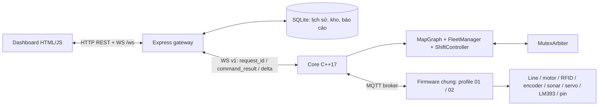

# Review hệ thống AGV — 29/10/2026

## Phạm vi và mức bằng chứng

SOURCE: yêu cầu review toàn hệ thống, chức năng module, hàm code, web và giao tiếp. Căn cứ yêu cầu hiện hành trong AGENTS.md, sổ yêu cầu, hợp đồng và ADR liên quan, ưu tiên ADR-090/091/092/093. Mốc mã: `6c215190acbff720e9fda51821a0968f47716c26`; working tree sạch lúc bắt đầu.

OBSERVED: review tĩnh các module ứng dụng hiện hành và các luồng xuyên web–gateway–Core–firmware; chạy riêng nhóm kiểm tra JavaScript không cần mạng được ghi ở cuối báo cáo. Các phát hiện dưới đây có điều kiện tái hiện từ mã; chưa tái hiện chúng trên xe. Không thể suy ra chất lượng từng nhánh chỉ từ số lượng hàm hoặc một bộ test PASS.

PROPOSED: hướng sửa trong báo cáo để người dùng xem xét, chưa sửa ứng dụng, chưa trở thành yêu cầu thiết kế được duyệt. Không đổi cấu hình hai xe, DB vận hành, counter, binary hoặc dịch vụ. Không test/build/nạp firmware.

Phạm vi chính: `AGVwebserver`, `src/core`, `include` trừ thư viện JSON, `firmware/NCKHAGV/src`, `simulation`, hợp đồng và script chạy/build liên quan. Sketch `AGV_Connection_Test` chỉ được xem như bản lịch sử/thử kết nối, không phải firmware vận hành v25. Không khảo sát nội bộ thư viện vendored, node_modules, artifact cũ hoặc nội dung DB đang dùng. Danh mục file/ký hiệu bổ sung ở [mục lục hàm](function-index-2026-10-29.md); đây là chỉ mục tra mã, không phải chứng nhận kiểm chứng mọi hàm.

## Các phát hiện cần xử lý

### R1 — P1: checkpoint mất chốt kệ đang chở hoặc lift chưa rõ kết quả

Vị trí: [durableSnapshot/restore](../../include/core/FLeetmanager.hpp#L175), [giá trị mặc định AGV](../../include/core/FLeetmanager.hpp#L100), [returnToHome](../../include/core/FLeetmanager.hpp#L328), [điều kiện mở ca](../../include/core/ShiftController.hpp#L162).

`durableSnapshot()` lưu `dropoff_exit_pending` và ID lift dưới tên `dropoff_lift_command_id`, nhưng không lưu cargo hold tổng quát sau `DONE_UP` hoặc khi lift đang chạy/bị ngắt. `restore()` chỉ dùng ID này khi pending exit là true và dựng `AGV` mới; nếu không có pending exit thì `virtualCargo=false`, `virtualCargoKnown=false`, `liftCommandId=0`. Diagnostic mới chỉ đồng bộ cargo của lift đang được Core theo dõi hoặc pending exit; không khôi phục chốt này từ một `DONE_UP` tự do.

Điều kiện xảy ra: đã nâng kệ, hoặc nâng/hạ bị ngắt chưa rõ kết quả → checkpoint → restart Core → nhận RFID/diagnostic mới và thực hiện phục hồi. Vị trí/hướng vẫn bị khóa lúc đầu, nhưng sau khi phục hồi thì điều kiện `virtualCargo || (liftCommandId>0 && !virtualCargoKnown)` không còn giữ xe. Core có thể coi xe đủ điều kiện về trạm/mở ca dù việc đối soát kệ chưa được hoàn tất. Sổ kho gateway có thể vẫn giữ kệ trên xe, tạo hai nguồn trạng thái mâu thuẫn. Đây không phải khẳng định restart lập tức làm xe chạy; các chốt phục hồi khác vẫn tồn tại.

PROPOSED: lưu một cargo hold bền vững cho mọi thao tác nâng/hạ chưa đối soát, kèm ID/ngữ cảnh cần thiết. Sau restart khôi phục dưới dạng chưa xác minh, không khôi phục proof cảm biến, phiên MCU hoặc quyền chạy. Chỉ gỡ hold bằng bằng chứng trống/đối soát phù hợp. Áp dụng cùng logic cho 01/02.

### R2 — P2: thao tác kho độc lập thiếu đường đối soát khi mất ngữ cảnh

Vị trí: [actions chỉ ở RAM](../../AGVwebserver/warehouse-actions.js#L10), [resume](../../AGVwebserver/warehouse-actions.js#L28), [đặt chỗ bền vững](../../AGVwebserver/warehouse-actions.js#L118), [khóa lượt chưa đối soát](../../AGVwebserver/warehouse-inventory.js#L123), [route phục hồi hiện có](../../AGVwebserver/gateway.js#L337).

`warehouse_actions` chỉ lưu trong mảng RAM, trong khi move `action:<id>` và vị trí kệ được lưu SQLite. Restart gateway làm mất action/pha/lift ID, nhưng inventory vẫn chuyển move/kệ sang `needs_attention`. API action hiện có create/resume; resume chỉ chấp nhận action còn trong RAM và pha vận chuyển, không có resolve/rollback tương đương đơn hàng. Nút hoàn tác ở khối kho cũng chỉ tìm move gắn với `order:<id>:<item>`.

Nếu đã nâng kệ rồi gateway restart hoặc servo của action bị gián đoạn, đặt chỗ cũ chặn tạo action mới. Đối soát toàn kho đòi CLOSED, còn kệ/cargo chưa rõ có thể giữ Core ở CLOSING. Người vận hành thiếu luồng web hoàn chỉnh để xử lý tình huống này. Không nên chữa bằng xóa move/DB hoặc bỏ chốt cargo.

PROPOSED: giữ ngữ cảnh action bền vững như hồ sơ gián đoạn, tuyệt đối không tự chạy lại; bổ sung thao tác đối soát theo ID/revision và proof dừng/cargo tương tự đơn. Phải phân biệt đã hạ thành công, còn trên xe và chưa rõ kết quả.

### R3 — P2: mất bản tin trả mutex có thể giữ vùng vô thời hạn

Vị trí: [queue release](../../firmware/NCKHAGV/src/network/MQTTModule.cpp#L217), [xóa proof sau enqueue](../../firmware/NCKHAGV/src/core/MutexClearance.h#L149), [releaseZone/retryGrants](../../include/utils/Mutexarbiter.hpp#L81).

MCU xóa hold cục bộ sau khi đưa release vào queue; worker bỏ queue khi `publish(..., false)` trả thành công. Bản tin dùng QoS 0, không có ACK ứng dụng cho release. Nếu kết nối đứt sau ghi socket hoặc Core tạm bỏ qua bản tin do storage không khỏe, MCU không giữ yêu cầu để gửi lại đến khi Core xác nhận. Core vẫn giữ owner; grant đã ACK cũng không được retry như grant chưa nhận.

Tác động chính là xe khác chờ vùng dù xe trước đã rời; cùng grant cũ bị MCU từ chối tái sử dụng là chốt đúng về an toàn, nhưng chưa giải quyết mất release. Đối soát tại trạm/thủ công có thể giải tỏa sau đó; không có bảo đảm tiến triển trong hành trình.

PROPOSED: bổ sung xác nhận release và retry idempotent theo `zone/grant_id/phiên`, hoặc cơ chế xác nhận tương đương từ Core. Mọi thay đổi phải cập nhật hai firmware, Core, hợp đồng và simulator cùng nhau; không nhả owner do timeout.

### R4 — P2: công việc cũ đang hoạt động có thể biến mất khỏi bảng hợp nhất

Vị trí: [browserState](../../AGVwebserver/gateway.js#L90), [query theo ID giảm dần](../../AGVwebserver/db.js#L142), [buildMissionRows](../../AGVwebserver/public/mission-model.js#L20).

Snapshot chỉ lấy 50 dòng task history mới nhất, không ưu tiên task `pending/dispatched/interrupted` cần xử lý. Bảng hợp nhất dựng task độc lập từ `task_history`, không bù từ toàn bộ `fleet.tasks`. Một task đang chạy lâu có thể bị hơn 50 dòng task mới đẩy khỏi bảng; filter/search phía browser cũng không tìm được vì chưa nhận dòng đó. Với đơn, cutoff 50 có ngoại lệ cho lịch sử được tham chiếu/move `needs_attention`, nhưng không giữ vô điều kiện mọi đơn active.

Tác động: mất hàng theo dõi/Chi tiết/Hủy ở bảng công việc dù Core vẫn giữ nhiệm vụ. API lịch sử có thể đọc nhiều hơn, nhưng bảng hiện tại không phân trang/nạp tiếp.

PROPOSED: luôn kèm mọi công việc chưa kết thúc/cần xử lý, giới hạn 50 chỉ áp dụng lịch sử terminal; bổ sung phân trang lịch sử và giữ liên kết theo ID/phiên. Không tăng giới hạn cố định như một cách chữa lâu dài.

### R5 — P2: gửi WebSocket chậm giữ khóa điều phối Core

Vị trí: [sendAll/wsSendText](../../src/core/AGVserver.cpp#L241), [broadcastState](../../src/core/AGVserver.cpp#L404), [tick và heartbeat](../../src/core/AGVserver.cpp#L1001).

`broadcastState()` giữ `g_stateMtx` trong lúc tuần tự gửi frame tới từng client. `sendAll()` là I/O đồng bộ. Send timeout 500 ms giới hạn từng lần gửi, không tách I/O khỏi khóa; client gửi lỗi cũng không được loại ngay trong broadcast. MQTT callback và tick/heartbeat cùng cần khóa này.

Gateway hoặc client Core không đọc kịp có thể tăng trễ xử lý telemetry/ACK và điều phối. Nhiều client chậm cộng dồn thời gian chờ, có thể làm MCU mất heartbeat 3 giây và dừng. Backpressure của WS gateway→browser đã có, nhưng không che được nhánh Core→gateway này.

PROPOSED: chụp snapshot dưới khóa, đưa vào queue gửi có giới hạn, gửi ngoài khóa điều phối, loại client lỗi/chậm; bảo vệ sequence/baseline theo từng client. Kiểm tra trường hợp gateway ngừng đọc trước khi áp dụng.

### R6 — P2: mô phỏng map bo góc đi đường chéo và tính thiếu quãng đường

Vị trí: [SimulationRuntime.edge](../../simulation/runtime.js#L22), [tích phân chuyển động](../../simulation/robot.js#L120), [tọa độ marker](../../simulation/public/simulation.js#L143), [geometry map](../../data/map_layout.json).

Runtime dùng `Math.hypot(dx,dy)` giữa hai node, bỏ `geometry.via/segment_lengths_cm`; marker mô phỏng cũng nội suy đường thẳng. Ví dụ G1→M1 trên map hiện tại có nhãn chiều dài 135 cm, hai đầu ở (0,70)/(50,0): mô phỏng dùng khoảng 86,02 cm. Ở 25 cm/s, thời gian cạnh là khoảng 3,44 s thay vì 5,40 s theo chiều dài được khai báo. Route cost vẫn dùng weight 135, nên số đo quãng đường, thời gian và tiêu hao pin không cùng mô hình với chi phí tuyến.

PROPOSED: dùng chiều dài khai báo của cạnh và cùng phép chiếu geometry khi tích phân/vẽ marker; giữ phân biệt tọa độ sơ đồ với số đo dọc line. Đây là sai lệch mô phỏng S1, không phải bằng chứng robot thật đi chéo.

### R7 — P2: sketch lịch sử có mật khẩu Wi-Fi trong file Git theo dõi

Vị trí: [khối cấu hình sketch](../../firmware/AGV_Connection_Test/AGV_Connection_Test.ino#L27).

File `.ino` được Git theo dõi và chứa trực tiếp SSID/mật khẩu Wi-Fi. Không chép giá trị vào báo cáo. Việc các file `LocalNetworkConfig*.h` của NCKHAGV đã được bỏ khỏi Git không bảo vệ bản cấu hình nằm trong sketch cũ; người nhận repo vẫn đọc được nó. Chưa xác minh thông tin này còn dùng được hay repo đã được chia sẻ cho ai.

PROPOSED: đưa cấu hình bí mật của sketch vào file cục bộ bị ignore, giữ template không có giá trị thực. Nếu thông tin còn hiệu lực và đã được chia sẻ ngoài phạm vi dự định, cần thay mật khẩu. Không tự đổi mạng xe hoặc sửa lịch sử Git trong lượt review.

## Bản đồ module và các nhóm hàm chính

### Core và thuật toán

| Module | Nhóm hàm | Vai trò và đánh giá |
| --- | --- | --- |
| `src/core/AGVserver.cpp` | `runCore`, `on_connect`, `on_disconnect`, `on_message`, `handleWebCommand`, `checkpointAndPublish`, `stateSnapshot`, `broadcastState` | Ghép MQTT/WS/storage và vòng điều phối. Parser kiểm topic, kích thước, retained và phần lớn kiểu/range. Checkpoint trước phát lệnh là điểm tốt; I/O WS dưới khóa còn R5. Tick thực tế chờ tối đa 200 ms ở vòng cuối, một số comment vẫn ghi 700 ms. |
| `MapGraph` | `loadFromJson`, `loadFromFile`, `saveToFile`, `findShortestPath`, `pathCost`, `nearestCharging`, obstacle/TTL, `edgeGeometry` | Nạp candidate rồi mới thay map; Dijkstra theo cạnh có hướng/trọng số không âm; so tổng weight, có bảo vệ overflow. Map hiện tại có 22 node, 35 bản ghi cạnh và bốn geometry ngoài. Không có cơ sở để đổi thuật toán chỉ vì muốn dùng A*. |
| `FleetManager` | `updateTelemetry`, `directGoto`, `addTask`, `dispatchPending`, `assignPath`, `sendCommand`, `reportAck`, `checkAcks`, `checkTimeouts`, `replanAGV`, `resumeBlocked` | Trạng thái xe/task, chọn xe theo chi phí với tie break ID, đặt chỗ và giữ footprint lỗi. Có WAIT/proof RFID khi đổi tuyến. Không tự chuyển task gián đoạn sang xe khác. |
| `FleetManager` — proof | `bindEncoderSession`, `observeOdometry`, `observeStoppedPosition`, `observeMotionDiagnostic`, `observeCargoSensor`, `observeLift`, `startLift` | Buộc boot/kết nối/seq/uptime, phân biệt estimate và RFID, theo dõi lift theo ID. Luồng hạ mới giữ kệ đến gate. Cần hoàn thiện cargo hold qua restart theo R1. |
| `FleetManager` — phục hồi | `recoverVerifiedNode`, `confirmRecoveryHeading`, `resumeTask`, `cancelTask`, `endShiftWork`, `reconcileTestCargo` | Tách reset lỗi, xác nhận hướng và tiếp tục nhiệm vụ. ACK không mở khóa hướng. Kết ca vô hiệu resume cũ; đối soát không phát servo. |
| `MutexArbiter` | `requestZone`, `grant`, `acknowledge`, `releaseZone`, `retryGrants`, `confirmClear`, `cancelWaiting`, `restore` | FIFO, grant ID, giữ owner khi mất mạng; stopped occupancy có thể chặn zone ngay cả khi owner trống. R3 nằm ở xác nhận trả quyền xuyên mạng. |
| `ShiftController` | `start`, `end`, `tick`, `snapshot`, `transition` | CLOSED/RUNNING/CLOSING, trạm riêng và phạm vi xe; kết ca hủy việc cũ rồi chờ proof. Scope khởi động không tự phát chạy. |
| Lưu bền và hình học | `CommandIds::next/ensureAbove`, `RuntimeStore::load/save/migrateRoundedMap`, `durableReplaceFile`, `NodeManeuver`, `EdgeGeometry` | Counter bền vững, không rewind; migration map có giới hạn, thay file nguyên tử, xác định rẽ/hướng và chiếu cạnh bo. Không khôi phục proof sống là đúng; phải giữ riêng hold chưa đối soát. |

### Gateway, đơn hàng và dữ liệu

| Module | Nhóm hàm | Vai trò và đánh giá |
| --- | --- | --- |
| `server.js`, `gateway.js` | `createGateway`, `connectCore`, `onState`, `requireCore`, `command`, `broadcast`, `start/close` | REST/WS browser, bridge có tương quan request/phiên, timeout trả unknown, stale gate, state delta và backpressure. Không tự apply snapshot lúc reconnect. |
| `orders.js` | `create`, `planQueued`, `eligible`, `dispatch`, `dispatchLift`, `processItem`, `runTick`, `resume`, `resolve`, `endShift`, `linkTaskHistory` | Đơn nhiều cặp nguồn/đích nhưng mỗi ô một kệ. Đặt chỗ trước giao, chờ task đúng xe và proof lift; đơn restart cần đối soát. Liên kết task bằng ID/phiên/khóa DB. |
| `order-planner.js` | `shortestRoute`, `shortestCost`, `planOrder` | Dijkstra ước lượng và ghép nguồn–đích bằng luồng chi phí nhỏ nhất; không thay quyền quyết định tuyến của Core. |
| `warehouse-actions.js` | `create`, `beginService`, `inspectAndStart`, `startServo`, `dispatch`, `advance`, `resume` | Nâng/hạ độc lập trong scope một xe; dùng chung proof cargo với đơn. Phục hồi khi mất ngữ cảnh còn R2. |
| `cargo-proof.js` | `cargoReading`, `cargoResult`, `loweredForExit`, `dropoffDoneAtGate` | Phân biệt sensor required/known/present, LOWERED tại kho và DONE_DOWN ở gate; không dùng ACK hoặc timer gateway làm kết quả hàng thật. |
| `warehouse-inventory.js` | `configure`, `assertPlan`, `reserve`, `confirmLift`, `confirmMissing`, `resumeMove`, `rollbackOrder`, `observeShift`, `finishShift` | Sổ kệ và đặt chỗ nguồn/đích/xe; transaction sổ kho + event, event key chống ghi hai lần, giữ mã kệ mất ở unknown. Báo cáo kho đầu/cuối ca bất biến. |
| `db.js` | `createDatabase`, `enqueueState/flush`, `syncTasks`, `interruptPreviousSession`, `computeKpiReport`, `prune` | SQLite WAL, lịch sử task/log, batch, KPI theo watermark, retention. KPI cohort task tạo trong kỳ khác `completed_in_period`; UI có mô tả khác biệt này, không coi đó là lỗi tính toán. |
| `location-names.js` | `snapshot`, `assertRevision`, `resolve`, `swap` | Đổi nhãn server có revision; giữ UID/ID vật lý/trạm riêng và ảnh tên trong lịch sử. |
| `shift-review.js`, `security.js` | `snapshot/reconcile/observe`, `authorized`, `originAllowed`, `middleware` | Đối soát bằng token bản chụp, giữ audit; kiểm token/Origin/loopback. HTTPS/MQTT TLS phụ thuộc cấu hình, chưa kiểm cấu hình vận hành trong lượt này. |

### Firmware dùng chung cho 01/02

| Module | Nhóm hàm | Vai trò và giới hạn |
| --- | --- | --- |
| `AGVController` | `begin`, `update`, `input`, `consumePriority`, `handleCommand`, `publishTelemetry`, `observeState` | Vòng điều khiển chung, ưu tiên STOP, kiểm mạng/sensor, nhận GOTO/NODE_ORDER/RESET/CONFIRM_HEADING/LIFT. Không suy profile hai xe là cùng PWM. |
| `CoreProtocol`, `CommandReplayGuard` | `decodeCommand`, `sameCommand`, `decodeGrant`, `classify`, codec telemetry/odometry | Parser có giới hạn path và ID 32-bit, dedup payload, cache + NVS high-water. Chặn ID cũ không nằm cache; ACK là nhận vào xử lý. |
| `MQTTModule`, `WiFiModule`, `NetworkHealth` | `begin/loop/connect`, `onMessage`, `persistCommandId`, `sendAck`, `sendTelemetry`, `sendOdometry`, `isConnected` | Worker mạng riêng, queue bounded, LWT/status, heartbeat và phiên, reconnect không replay vị trí cũ. R3 là khoảng trống release. |
| `RoutePlanner`, `CoreNavigator` | `plan`, `reverseAllowed`, `start`, `authorizeNodeOrder`, `reachedNode`, `update`, `observeTurnLine`, `confirmTurnAround`, `recoverLine` | Đi bảng RFID/map sinh sẵn; rẽ/quay/line, chờ quyền vùng và lệnh theo node; quay/docking có xác nhận line. Chiều chuyển động thực còn cần người dùng thử. |
| `MotorModule`, `MovementModule`, `LineFollowModule`, `LinePdController` | `drive/writeSide`, `apply/stop`, PD và chỉnh line | Driver L298N/BTS7960, PWM/trim riêng, bù mức pin, điều khiển tiến/lùi/quay. Không đổi tuning trong review. |
| `RFIDModule`, `EncoderModule`, `OdometryTracker`, `StoppedPosition`, `MutexClearance` | `readCard/finishRead`, `update/context/snapshot`, proof dừng/clearance | RFID xác nhận node, encoder ước lượng cạnh và hai bánh dừng; proof clearance không chỉ dựa vào việc hết đọc thẻ. Không chứng nhận độ chính xác/quãng phanh vật lý từ source. |
| `SensorModule`, `DirectionalSonar` | `echoInterrupt`, `update`, `valid`, chuyển sonar theo hướng | Sonar trước/sau, hysteresis, lấy echo không chặn dài. ECHO LOW timeout được coi ngoài tầm theo policy đã duyệt; không phân biệt được đứt dây LOW với không vật cản. |
| `BatteryModule`, `CargoModule` | `begin/update/calibrated`, `stable/present` | ADC lọc điện áp, phần trăm giữ khi motor chạy; LM393 GPIO2 HIGH=có hàng, debounce 150 ms theo source v25. Không đo ID kệ hoặc tải trọng. |
| `ServoModule`, `LiftCycle`, `BuzzerModule` | `liftUp/liftDown/update`, `start/update/exitRouteAllowed/observeExit` | Servo 5 s, DOWN→LOWERED→lùi một cạnh→DONE_DOWN khi trống ở gate; còi theo chuyển động. Chưa chứng minh góc cơ khí hoặc hàng rời xe trên phần cứng. |
| Config/profile | `Config.h`, `SharedRobotConfig`, `Robot01Config`, `Robot02Config`, `BatteryCalibration` | Chức năng chung, ID/mạng/hiệu chuẩn/PWM riêng. Build ID source: `20261029-robot01-dropoff-exit-v25` và `20261029-robot02-dropoff-exit-v25`; chưa build/test/nạp trong review. |

### Các chức năng web đang có

| Khu vực/module | Chức năng |
| --- | --- |
| Tổng quan / `dashboard.js` | Kết nối Web–Core–MQTT, ca, tạo đơn/chọn xe/đi tới node, khóa node, lịch sử xe và log. Control có khóa busy và stale. |
| `dashboard-vehicles`, `warehouse-operations` | Hai thẻ cố định 01/02, tuyến/đích/RFID/pin/tốc độ/tuổi dữ liệu/kệ và cảnh báo; chọn xe, khôi phục, gỡ offline; trạng thái sáu ô kho và đối soát đơn. |
| `dashboard-missions`, `mission-model` | Một bảng nhiệm vụ/kết quả theo đơn hoặc task độc lập, filter/search, chi tiết chặng, hủy, xóa logic, resume/rollback. R4 ảnh hưởng độ đầy đủ. |
| `dashboard-map` | SVG node/cạnh một chiều, bo góc, tuyến, heading, marker encoder ước lượng, sonar ước lượng, zoom/resize; lớp tĩnh được cache. |
| Bản đồ / `dashboard-location-names` | Hoán đổi nhãn K/S khi đủ điều kiện, revision chống form cũ; quản lý snapshot, preview/apply có thao tác chủ động. Form chỉnh node/cạnh đã bỏ khỏi UI, API còn giữ. |
| `dashboard-recovery` | Khôi phục dừng/lỗi, hỏi tình trạng nhấc/xoay, xác nhận hướng riêng, tiếp tục task/đơn/action và đối soát lỗi ca. |
| Báo cáo / `dashboard-reports`, `warehouse-ui` | KPI, hoạt động 01/02, chọn kỳ, sổ kho đầu/cuối ca, log chuyển kệ, tải JSON; nhập kho và dialog kiểm tra trước mở ca. |

Renderer chính dùng textContent/tạo DOM cho dữ liệu, không phát hiện đường inject HTML trực tiếp trong các module web hiện hành đã rà. Chưa chạy browser desktop/mobile trong review này; không suy layout PASS từ đọc CSS.

## Giao tiếp và trạng thái luồng

| Lớp | Dạng dữ liệu hiện tại | Ý nghĩa xác nhận |
| --- | --- | --- |
| Browser→gateway | HTTP JSON, gateway mặc định 3000; `/api/tasks`, `/api/agvs/:id/goto`, orders, warehouse, shift, recovery, map, history/KPI | HTTP thành công điều khiển nghĩa là Core đã chấp nhận lệnh tương ứng; chưa phải robot hoàn thành. API danh sách trả array trực tiếp. |
| Gateway→browser | `/ws?delta=1`, full snapshot rồi delta có base/state sequence | Browser mất baseline thì reconnect; dữ liệu cũ khóa control. Web online không đồng nghĩa mọi xe online. |
| Gateway↔Core | WS v1, mặc định loopback 8080, JSON `request_id/command_result/core_session_id`; snapshot/delta | Gateway chờ đúng request và phiên. Timeout/mất kết nối là unknown; không tự gửi lại thao tác gây chuyển động. |
| Core→robot | MQTT `agv/{id}/command`, JSON `cmd/cmd_id`, không retained, QoS 0 | GOTO, WAIT/STOP, NODE_ORDER, RESET_FAULT, CONFIRM_HEADING, LIFT_UP/DOWN; CHARGE_START có trong protocol nhưng tự sạc hiện tắt. |
| Robot→Core | `telemetry`: `node|battery|obstacle`; ACK: số dạng text | Firmware mới gửi pin pipe `?`, phần trăm nằm ở diagnostic. ACK chỉ xác nhận tiếp nhận/dedup. Không phải MQTT transport ACK hoặc kết quả chuyển động. |
| Robot→Core | diagnostic JSON version 1, odometry JSON schema 1, status/LWT và error | Diagnostic ràng buộc boot/kết nối/Core session, trạng thái motor, hướng, lift/cargo; odometry là ước lượng, RFID mới xác nhận node. Error text/pipe còn là hợp đồng cũ, không có session trong mọi bản tin. |
| Mutex | request text zone; grant/ACK/release JSON có grant_id | Grant/ACK có retry, không retained movement; mất telemetry không được xem là đã ra khỏi zone. Release còn R3. |

Luồng đơn bình thường: đặt chỗ → GOTO kho lấy → task đúng xe completed + IDLE/RFID → kiểm LM393 → LIFT_UP → DONE_UP đúng ID/có hàng → ghi kho→xe → GOTO kho giao → LIFT_DOWN → LOWERED → GOTO một cạnh kho→gate → DONE_DOWN đúng ID/cảm biến trống + task gate completed → ghi xe→kho → delivered.

Luồng lỗi: giữ footprint và owner; WAIT/hủy không chứng minh dừng. Phục hồi cần proof mới, reset nếu cần, xác nhận hướng khi bị khóa, sau đó mới cho resume cùng ca. Restart/kết ca không tự phát lại servo hoặc nhiệm vụ cũ.

## Mô phỏng, phần đã có và giới hạn

`simulation/server.js` dựng broker/Core/DB/map/counter riêng; `launcher.js`/viewer quản lý vòng đời theo tab, `runtime.js` quản lý robot/kịch bản/đơn và số liệu, `robot.js` nhận command/ACK/mutex/heartbeat, `mqtt.js` là client mô phỏng. Đây là mô hình điểm S1, chưa phải mô phỏng quãng phanh/hình bao thân xe.

Ngoài R6, simulator vẫn có máy đơn riêng và robot giả chưa sản xuất đầy đủ diagnostic cargo/servo/heading confirmation như firmware v25. Vì vậy PASS của mô phỏng di chuyển cũ không đủ chứng minh luồng LM393/LOWERED/gate hoặc phục hồi hướng hiện tại. Cần fixture hợp đồng mới hoặc adapter tương ứng khi người dùng giao phần kiểm chứng này.

Các thiết lập chủ ý, không đánh dấu lỗi: Core đang `setBatteryTestBypass(true)` và `setAutomaticChargingEnabled(false)` theo yêu cầu thử; firmware vẫn có chốt điện áp riêng. S1/S2 là trạm riêng nhưng không có đo dòng sạc/charger thật. Tọa độ map là sơ đồ, encoder/sonar trên web là ước lượng.

OPEN cần chốt trước khi siết thêm: tuổi RFID cho phép trước nâng/hạ. Hiện Core/MCU kiểm đã định vị trong phiên, nhưng nhánh trước lift không bắt `rfidAgeMs<=250` như phục hồi/xác nhận hướng/gate exit. Đây là khoảng trống policy cần xác nhận, chưa kết luận vi phạm một ngưỡng trước lift đã được duyệt. Không tự thay điều kiện này trong review.

Tài liệu/kỹ năng còn giữ khảo sát lịch sử như “chưa có load_map_data”, “hoàn thành từ target”, header trong src và firmware chưa tồn tại. Mã hiện tại đã thay các điểm đó. Nên tách tài liệu CURRENT và HISTORY, cập nhật đường dẫn entrypoint/hàm, không xóa hồ sơ yêu cầu cũ.

## Kiểm tra đã thực hiện và phần còn mở

- Đọc/đối chiếu mã hiện tại, hợp đồng, sổ yêu cầu và ADR liên quan; xác định tham chiếu nguồn của bảy phát hiện. Chưa chạy kịch bản tái hiện R1–R7.
- Chạy nhóm không cần mạng: `node --test --test-reporter=dot --test-isolation=none tests/orders.test.js tests/warehouse-actions.test.js tests/warehouse-inventory.test.js tests/mission-model.test.js tests/cargo-sensor.test.js tests/dashboard-battery.test.js`: **66/66 PASS**, DB thử riêng/in-memory. Đây là kiểm tra server/web, không chạy source firmware.
- Lần chạy gộp có gateway/security ban đầu gặp `connect EACCES 127.0.0.1:<cổng fixture>` trong sandbox; tiến trình đã được dừng, không có kết quả tổng hợp hợp lệ cho lần chạy đó. Không ghi lỗi môi trường này thành lỗi sản phẩm.
- Yêu cầu chạy lại gateway/security ngoài sandbox bị bộ xét duyệt tự động từ chối, với lý do diễn giải quy tắc người dùng là không chạy test trong lượt review. Không thử lách hoặc chạy lại sau từ chối. Muốn hoàn tất riêng nhóm WebSocket localhost cần người dùng cho phép rõ; nhóm này dùng Core/SQLite giả, không kết nối robot hoặc DB vận hành.
- Không build/chạy Core mới, không chạy browser, không chạy mô phỏng, không test/build/nạp firmware, không đo trên xe thật. Source v25 chưa được chứng nhận bởi kết quả 66 ca JavaScript.

Thứ tự đề xuất: R1 → R2/R3 → R4/R5 → R6; xử lý R7 trước lần chia sẻ source tiếp theo. Mỗi lần sửa firmware phải giữ cả hai profile và tuân thủ quy trình người dùng tự nạp/thử. Báo cáo này chỉ thêm tài liệu review; chưa áp dụng các hướng sửa.
